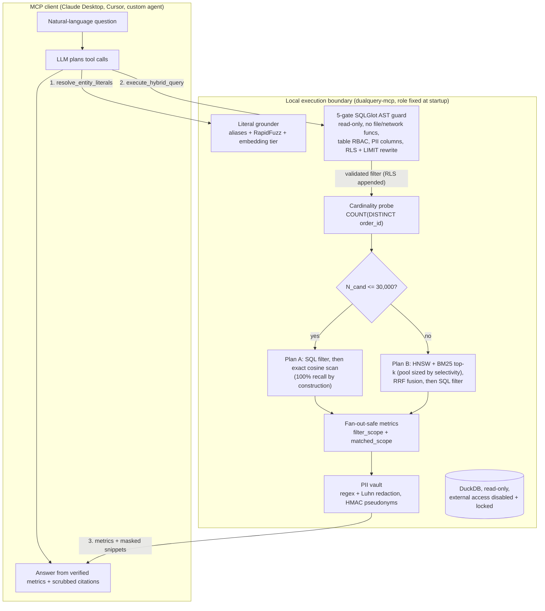

# DualQuery (`dualquery-mcp`)

[](https://github.com/Zayf24/DualQuery/actions/workflows/ci.yml)


**DualQuery** is a zero-trust hybrid relational-semantic query engine exposed as a Model Context Protocol (MCP) server. An LLM agent asks questions that need both SQL math and semantic search over free text ("how much revenue came from Rio de Janeiro orders whose reviews complain about broken packaging?"). DualQuery runs the SQL filter, vector + BM25 retrieval, aggregation and PII redaction **inside DuckDB on the local machine**, and only returns metrics and scrubbed, pseudonymized evidence to the model.

Built with Python, DuckDB (`vss` HNSW, `fts` BM25), SQLGlot, SentenceTransformers / FastEmbed (`BAAI/bge-base-en-v1.5`), RapidFuzz, and the official MCP SDK (`stdio`, `SSE`, `streamable-http`).

---

## The problem

Business truth is split between tables (orders, payments, delivery dates) and text (reviews, tickets, return notes):

* **Vector RAG alone** cannot do exact `SUM` / `COUNT` / joins.
* **Text-to-SQL alone** falls back to brittle `LIKE '%broken%'` and silently returns zero rows on unknown enum spellings.
* **Stuffing rows into the context window** is slow, error-prone for arithmetic, and ships PII to a third party.
* **Generic database MCP servers** run raw SQL and serialize raw rows over JSON-RPC.
* **Filtered vector search done naively** (ANN top-k, then apply the SQL filter) loses most results when the filter is selective. Measured on this dataset: **14.7% recall@10** when the filter keeps ≤ 5,000 of 99,441 orders (see benchmarks).

---

## Architecture



### Key design decisions

* **One validated filter, used everywhere.** The SQL filter is parsed by the AST guard once; the rewritten `WHERE` clause (aliases expanded, the role's row-level-security predicate appended with correct precedence) is the only filter the probe, both plans and every metric query execute.
* **Fan-out-safe aggregation.** Each metric runs over the *distinct* set of matching orders and joins only the table it needs, so a filter on `order_items` can never multiply a `SUM` over `order_payments`. A metric that mixes two one-to-many tables is rejected with an actionable error instead of returning an inflated number.
* **Two metric scopes.** `filter_scope` covers every order matching the SQL filter. `matched_scope` covers only those orders with a review in the top *X%* most similar to the semantic query (default 1%, per-query rank cutoff). Answers like "N customers complained about X" come from `matched_scope`, not from the whole filter.
* **Measured cost-based planning.** A `COUNT(DISTINCT order_id)` probe picks Plan A (exact) or Plan B (ANN). The 30,000-order switch point is the measured latency crossover on this dataset. Plan B's vector CTE is a plain `ORDER BY distance LIMIT k`, so DuckDB actually uses the HNSW index (verified in tests via `EXPLAIN`). Its candidate pool grows as the filter gets more selective.
* **Defense in depth.** The DuckDB handle is read-only, with `enable_external_access = false` and `lock_configuration = true`. Even a guard bypass cannot read files, call `getenv`, or re-enable access.
* **Role fixed by the operator.** `dualquery serve --role seller_restricted` sets the policy for the server's lifetime. The calling model cannot choose or escalate its role, and unknown roles fail at startup.

---

## MCP tools

| Tool | What it does | Safety behavior |
| :--- | :--- | :--- |
| `get_governed_catalog()` | Tables, columns, relationships and metric hints for the server's role | Restricted tables are omitted for lower-privilege roles |
| `resolve_entity_literals(terms)` | Maps "Rio de Janeiro" → `RJ`, "cosmetics" → `health_beauty`, "credit card" → `credit_card` | Exact / alias / RapidFuzz tiers, then embedding similarity over category names |
| `execute_hybrid_query(sql_filter, semantic_query, aggregations, limit, match_top_percent)` | Hybrid retrieval + metrics | AST-validated, RLS-scoped, fan-out-safe metrics; citations PII-scrubbed and HMAC-pseudonymized; DB errors reduced to one line (no SQL or paths) |

Example response (real run, analyst role, filter `customers.customer_state = 'RJ'`, query "product arrived broken and damaged"):

```json
{
  "status": "success",
  "plan_type": "Plan A",
  "estimated_candidates": 12852,
  "aggregates": {
    "filter_scope":  {"orders": 12852, "metrics": {"orders": "12852", "paid": "2144379.69"}},
    "matched_scope": {"orders": 49,    "metrics": {"orders": "49",    "paid": "14582.00"}}
  },
  "citations": [{"order_id": "[ORD_3C1CE516]", "review_snippet": "O produto vei errado nao esta de acordo com a descriçao..."}]
}
```

---

## Verification & benchmarks

All numbers come from the committed scripts, run on the full Olist dataset (99,441 orders, 40,659 embedded reviews) on an Intel i5-13450HX laptop with an RTX 4050 GPU. Result files are in `benchmarks/`.

| Suite | Result | Command |
| :--- | :--- | :--- |
| **Test suite** | **100 passed**. Fixture DuckDB + fake embedder, so CI needs no model download. Covers RLS on both plans, fan-out-safe sums, matched scope, HNSW use via `EXPLAIN`, sandboxing, MCP tools, BYOE, PII vault and the guard. Re-introducing each of the five original engine bugs fails 3–20 tests. | `uv run --extra dev pytest` |
| **Red-team AST guard** | **30/30 attacks blocked at the expected gate**: DDL/DML, multi-statement, file/network table functions, CTE smuggling, cross-role tables, PII columns, PRAGMA/ATTACH | `uv run python benchmarks/evaluate_security.py` |
| **Filtered retrieval** (62 golden queries) | Ground truth = exact filtered top-10. ANN-then-filter with a fixed pool of 150 reaches recall@10 of **0.147** at N ≤ 5k, **0.893** at 5k–20k, and **0.988** at N > 30k. Selectivity-sized pools lift 5k–20k to **0.980**. The planner sends everything ≤ 30k to the exact plan (1.0 by construction). | `uv run python benchmarks/evaluate_retrieval.py` |
| **Optimizer** (62 queries, both plans run) | Chose the faster retrieval plan in **62/62** queries. Retrieval SQL p50: **90 ms** (Plan A, 54 queries) and **74 ms** (Plan B, 8 queries). Full engine turn p50 (embed + probe + retrieval + both metric scopes + PII scrub): **426 ms** and **404 ms**. | `uv run python benchmarks/evaluate_optimizer.py` |

### Known limitations

* **Language mismatch:** `bge-base-en-v1.5` is an English model, but Olist reviews are Portuguese. Nearest-review cosine distances are 0.26–0.49, which is why `matched_scope` uses a per-query rank cutoff instead of a fixed distance. A multilingual 768-d model (e.g. `intfloat/multilingual-e5-base`) is the obvious next step and needs only a re-ingest.
* **Approximate matched scope:** `matched_scope` takes the global top-X% from the HNSW index, so it inherits HNSW's approximation. Filtered ANN recall@10 for broad filters measured 0.988 above; matched-scope recall is not separately benchmarked.
* **Hardware-specific threshold:** the 30,000 switch point was measured on the hardware above; re-run `evaluate_optimizer.py` on new hardware.

---

## BYOE financial leakage audit (zero-setup demo)

The repo ships a 500-transaction sample (`data/commercial_case_study/`). `dualquery audit` maps arbitrary CSV headers to a canonical schema, embeds the complaint notes, assigns each note to a root-cause prototype, and attributes money to clusters. A transaction with several notes is counted **once**, in the cluster of its earliest note, so cluster totals add up exactly.

```text
> uv run dualquery audit -t data/commercial_case_study/transactions.csv -f data/commercial_case_study/returns_notes.csv

Total Ingested Transactions: 500
Audited Complaint Notes: 160 (32.0% Incident Rate)
Total Gross Revenue at Risk: $84,272.65
Total Logistics / Freight Loss: $13,413.09
Total Financial Leakage: $97,685.74
Primary Leakage Driver: Packaging & Transit Damage
```

Each `audit` / `ingest` run writes a fresh `byoe_audit.duckdb`; a second dataset never mixes with the first.

---

## Quick start

### 1. Install

```bash
git clone https://github.com/Zayf24/DualQuery.git
cd DualQuery
uv sync --extra dev
```

### 2. Run the audit demo (no external data needed)

```bash
uv run dualquery audit -t data/commercial_case_study/transactions.csv -f data/commercial_case_study/returns_notes.csv -o data/commercial_case_study/audit_summary.json
```

### 3. Build the Olist database for the MCP server

Download the [Olist dataset from Kaggle](https://www.kaggle.com/datasets/olistbr/brazilian-ecommerce) into `data/olist_dataset/`, then:

```bash
uv run dualquery ingest-olist
```

Add `--max-reviews 2000` for a quick partial build. A full build embeds about 40k reviews (fast on a GPU, slower on CPU). To serve a database stored elsewhere, set `DUALQUERY_DB_PATH`.

### 4. Start the MCP server

```bash
uv run dualquery serve --role analyst
```

```bash
uv run dualquery serve --role seller_restricted --transport streamable-http --host 127.0.0.1 --port 8000
```

Client configuration (`claude_desktop_config.json` / `.cursor/mcp.json`):

```json
{
  "mcpServers": {
    "dualquery": {
      "command": "uv",
      "args": ["--directory", "/path/to/DualQuery", "run", "dualquery-mcp", "--role", "analyst"]
    }
  }
}
```

### 5. Test and benchmark

```bash
uv run --extra dev pytest
```

```bash
uv run python benchmarks/evaluate_retrieval.py
```

---

## Repository structure

```text
dualquery/
├── src/dualquery/
│   ├── cli.py                  # ingest, ingest-olist, audit, serve
│   ├── config.py               # paths (DUALQUERY_DB_PATH), model, Plan A/B threshold
│   ├── engine/                 # executor, cardinality probe, physical planner, grounder, audit runner
│   ├── ingestion/              # BYOE CSV mapper, Olist loader, literal indexer, embedding providers
│   ├── mcp/                    # MCP server, tools, role selection
│   └── security/               # 5-gate SQLGlot AST guard, PII vault
├── benchmarks/                 # golden hybrid queries, retrieval / optimizer / red-team benchmarks + results
├── scripts/verify_phase1.py    # manual smoke check of a built Olist database
├── data/commercial_case_study/ # 500-row sample transactions + return notes
├── sql/                        # DuckDB schema
└── tests/                      # fixture DB tests: executor, MCP, BYOE, PII vault, guard
```

---

## License

Released under the [MIT License](LICENSE).
