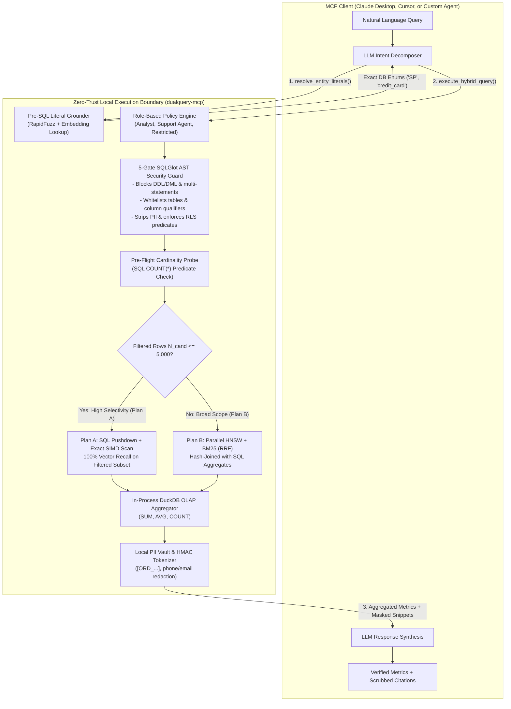

# DualQuery (`dualquery-mcp`)

[](https://github.com/Zayf24/DualQuery/actions/workflows/ci.yml)


**DualQuery** is a zero-trust hybrid relational-semantic query engine and Model Context Protocol (MCP) server built with **Python**, **DuckDB**, **SQLGlot**, **FastEmbed/PyTorch**, and the **Official MCP SDK (`stdio`, `SSE`, `Streamable HTTP`)**. It compiles natural language business questions into cost-optimized execution plans across structured SQL tables and unstructured text records without exposing raw database rows or PII to external LLM contexts.

---

## Core Engineering Problem

Operational enterprise datasets split truth across structured OLTP/OLAP tables (orders, payments, inventory, shipping dates) and unstructured text (customer reviews, support tickets, return remarks). Existing approaches fail in predictable ways:

* **Pure Vector RAG:** Cannot execute deterministic SQL aggregations (`SUM`, `AVG`, `COUNT`, `GROUP BY`) or multi-table foreign-key joins.
* **Pure Text-to-SQL:** Relies on brittle `LIKE '%...%'` filters that miss semantic equivalents and frequently fails on ungrounded enum literals.
* **Long-Context Table Stuffing:** Streaming tens of thousands of raw rows into cloud LLMs incurs high token latency (25–40s), causes arithmetic hallucinations, and leaks regulated PII externally.
* **Standard Database MCP Servers:** Execute raw `SELECT` statements and serialize sensitive table rows directly over JSON-RPC.

DualQuery resolves this through **Plan-Shipping**: SQL filtering, OLAP math, HNSW + BM25 vector retrieval, and PII redaction all execute in-process inside DuckDB. Only verified aggregates and scrubbed citations cross the MCP transport boundary.

---

## System Architecture



### Key Architectural Decisions

* **Unified Single-Engine Storage (DuckDB):** Relational tables, 768-dimensional BGE-Base embeddings (`FLOAT[768]`), HNSW (`vss`), and BM25 full-text (`fts`) indexes run inside one embedded database (`olist.duckdb` / `byoe_audit.duckdb`), eliminating cross-process vector ID synchronization overhead.
* **Cardinality-Aware Physical Planner:** Before running vector search, a pre-flight `COUNT(*)` probe measures predicate selectivity. Subsets with `<= 5,000` candidates route to **Plan A** (exact SIMD cosine distance scan over SQL-filtered rows for 100% recall); broader queries route to **Plan B** (HNSW + BM25 Reciprocal Rank Fusion hash-joined with SQL tables).
* **5-Gate `SQLGlot` AST Firewall (`ast_guard.py`):** Parses SQL filters into abstract syntax trees to block DDL/DML statements, multi-statement payloads, denied tables, and unauthorized `Column.table` qualifiers (preventing queries such as `SELECT ... WHERE order_payments.payment_value > 500` under restricted roles), while injecting mandatory Row-Level Security filters.
* **Pre-SQL Entity Literal Grounding (`literal_grounder.py`):** Grounds conversational phrases to exact database enum values before SQL generation to prevent silent zero-row queries.

---

## MCP Tool Interface

`dualquery-mcp` exposes three typed JSON-RPC 2.0 tools over `stdio`, `sse`, and `streamable-http` transports:

| Tool Name | Responsibility | Security & Behavior |
| :--- | :--- | :--- |
| `get_governed_catalog(role)` | Returns authorized tables, columns, and metrics | Dynamically omits restricted financial tables for lower-privilege roles |
| `resolve_entity_literals(terms)` | Maps free-text strings to canonical DB enum values | Hybrid fuzzy trigram (`RapidFuzz`) + embedding matching |
| `execute_hybrid_query(...)` | Runs AST-validated SQL + semantic retrieval | Computes exact DuckDB OLAP aggregates, returns top-K HMAC-tokenized citations |

---

## Live Audit Example (Zero-Setup CSV Mode)

The repository includes a 500-transaction sample dataset (`data/commercial_case_study/`) to run DualQuery's automated Bring-Your-Own-Export (BYOE) financial leakage pipeline with no external database configuration:

```text
> dualquery audit -t data/commercial_case_study/transactions.csv -f data/commercial_case_study/returns_notes.csv

Total Ingested Transactions: 500
Audited Complaint Notes: 160 (32.0% Incident Rate)
Total Gross Revenue at Risk: $84,272.65
Total Logistics / Freight Loss: $13,690.48
Total Financial Leakage: $97,963.13
Primary Leakage Driver: Packaging & Transit Damage
```

---

## Verification & Benchmarks

All quantitative metrics below are backed by committed evaluation scripts and automated test suites:

| Evaluation Suite | Result | Reproducible Command |
| :--- | :--- | :--- |
| **Automated Test Suite (`pytest`)** | **33/33 passed** (BYOE pipeline, MCP tool RBAC/execution, security compiler) | `uv run --extra dev pytest -v` |
| **5-Gate AST Adversarial Security** | **30/30 blocked (100.0%)** across DDL/DML, CTE smuggling & column-qualifier probes | `uv run pytest tests/test_security_compiler.py -v` |
| **Physical Optimizer Plan Accuracy** | **50/50 matched (100.0%)** (`Plan A`: 315ms P50 / 409ms P95; `Plan B`: 1,003ms P50) | `uv run python benchmarks/evaluate_optimizer.py` |

*(Latency numbers in `benchmarks/optimizer_benchmark_results.json` measure end-to-end local query embedding, cardinality probe, hybrid execution, OLAP aggregation, and PII scrubbing on 99k+ Olist records).*

---

## Tech Stack & Dependencies

* **Protocol & Server:** Official Python `mcp` SDK (`MCPServer`, `stdio`, `SSE`, `Streamable HTTP`), JSON-RPC 2.0, Pydantic v2
* **Storage & Indexing:** DuckDB (`vss` HNSW vector index, `fts` BM25 full-text index), PyArrow, Pandas
* **Embeddings & Grounding:** FastEmbed (CPU ONNX), SentenceTransformers / PyTorch (`BAAI/bge-base-en-v1.5`), RapidFuzz
* **Security & CLI:** SQLGlot (SQL AST parsing & rewriting), HMAC-SHA256 tokenization, Rich, Pytest

---

## Repository Structure

```text
dualquery/
├── src/dualquery/
│   ├── cli.py                  # Unified CLI (ingest, audit, serve)
│   ├── config.py               # Runtime paths, embedding model, cardinality limit
│   ├── engine/                 # Cardinality probe, physical planner, executor, audit runner
│   ├── ingestion/              # BYOE CSV fuzzy mapper, Olist loader, embedding providers
│   ├── mcp/                    # Official MCPServer tools and transport handlers
│   └── security/               # 5-gate SQLGlot AST compiler and local PII vault
├── benchmarks/                 # 50-query optimizer harness & 30-attack red-team suite
├── data/commercial_case_study/ # Sample 500-row ERP transaction + return note CSVs
├── sql/                        # DuckDB DDL and index initialization schema
└── tests/                      # Unit, BYOE E2E, MCP server, and adversarial security tests
```

---

## Quick Start

### 1. Install Dependencies

```bash
git clone https://github.com/Zayf24/DualQuery.git
cd DualQuery
uv sync --extra dev
```

### 2. Run the Commercial Financial Audit Demo

```bash
uv run dualquery audit \
  --transactions data/commercial_case_study/transactions.csv \
  --feedback data/commercial_case_study/returns_notes.csv \
  --output-json data/commercial_case_study/audit_summary.json
```

### 3. Start the Zero-Trust MCP Server

```bash
# Default stdio transport (Claude Desktop / Cursor)
uv run dualquery serve

# Networked Streamable HTTP or SSE transport
uv run dualquery serve --transport streamable-http --host 127.0.0.1 --port 8000
uv run dualquery serve --transport sse --host 127.0.0.1 --port 8000
```

#### Client Configuration (`claude_desktop_config.json` / `.cursor/mcp.json`)

```json
{
  "mcpServers": {
    "dualquery": {
      "command": "uv",
      "args": ["--directory", "/path/to/DualQuery", "run", "dualquery-mcp"]
    }
  }
}
```

### 4. Run Tests

```bash
uv run --extra dev pytest -v
```

---

## License

Released under the [MIT License](LICENSE).
