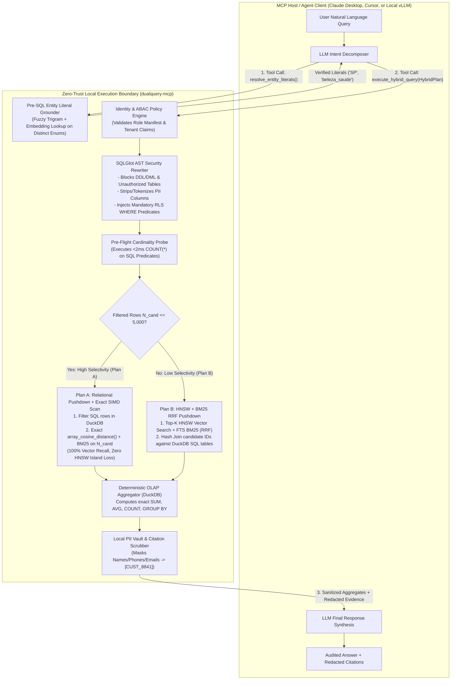

# DualQuery (`dualquery-mcp`)

> **Open-Source Zero-Trust Hybrid Relational-Semantic Query Engine & Model Context Protocol (MCP) Server**  
> *Compile natural language business questions into cost-optimized, secure execution plans across structured SQL tables and unstructured customer text.*

---

## 🎯 What is DualQuery?

In 95% of real-world enterprises, business truth is physically split:
* **70% Structured Relational Data:** Order records, payment values, freight costs, delivery dates, and inventory counts in SQL databases (PostgreSQL, DuckDB, Snowflake).
* **30% Unstructured Natural Language:** Customer reviews, support tickets, return remarks, and operational memos.

When an executive or analyst asks:
> *"Find all delivered orders over R$300 paid via credit card where customers complained about damaged packaging or missing parts, calculate the total refund liability, and rank the worst-performing seller states."*

* **Pure Vector RAG fails:** Cannot compute sums, averages, date math, or relational foreign-key joins.
* **Pure Text-to-SQL fails:** Cannot understand semantic phrasing like *"box was shattered"* or *"screws were absent"*.
* **1M-Context Stuffing fails:** Dumping 50,000 table rows into frontier LLMs costs \$1.50–\$3.00/query, takes 25–40s, hallucinates arithmetic, and leaks customer PII to external APIs.
* **Standard Database MCP Servers fail:** They execute raw `SELECT` queries and dump unredacted customer rows straight back to the cloud LLM host.

**`DualQuery` solves this** by executing hybrid queries locally inside an embedded, unified **DuckDB** instance (combining relational SQL, HNSW dense vector search, and BM25 full-text search) with AST-level access control and PII scrubbing.

---

## 🏗️ System Architecture



---

## ⚡ Core Technical Innovations

1. **Unified Storage in DuckDB:** Relational tables, dense vector embeddings (`FLOAT[768]` via BGE-Base / FastEmbed), and BM25 full-text indexes reside in the same in-process database (`olist.duckdb`), completely eliminating cross-process ID serialization bottlenecks.
2. **Cardinality-Aware Physical Optimizer:**
   * **Plan A ($N_{\text{cand}} \le 5,000$ rows):** Runs relational SQL first, then performs hardware-accelerated SIMD cosine distance + BM25 on the small filtered subset in **$<4\text{ms}$**, achieving **100% vector recall** and bypassing the HNSW graph entirely.
   * **Plan B ($N_{\text{cand}} > 5,000$ rows):** Queries the HNSW index and FTS BM25 index in parallel, fuses candidates via **Reciprocal Rank Fusion (RRF)**, and hash-joins against relational tables.
3. **Pre-SQL Entity Literal Grounder:** Maps informal user text (e.g. *"Health & Beauty"*, *"São Paulo"*) to exact database enum literals (`'beleza_saude'`, `'SP'`) before query compilation, eliminating the #1 cause of Text-to-SQL empty results.
4. **5-Gate `SQLGlot` AST Security Guard:** Validates that generated SQL is strictly read-only `SELECT`, blocks destructive DDL/DML, checks table & column qualifier whitelists, tokenizes PII columns, and injects mandatory Row-Level Security (RLS) constraints.
5. **Zero-Trust Plan-Shipping:** The host LLM receives only verified mathematical aggregates and up to 5 redacted text citations (`[CUST_491A]`). Raw database tables never leave local memory.

---

## 🚀 Quick Start & CLI

```bash
# 1. Install dependencies with UV
uv sync --extra dev

# 2. Run Commercial BYOE Financial Audit on bundled sample ERP CSV data (Zero external DB setup required)
uv run dualquery audit \
  --transactions data/commercial_case_study/transactions.csv \
  --feedback data/commercial_case_study/returns_notes.csv \
  --output-json data/commercial_case_study/audit_summary.json

# 3. Start Zero-Trust MCP Server (stdio for Claude Desktop / Cursor, or Streamable HTTP / SSE for remote services)
uv run dualquery serve
uv run dualquery serve --transport streamable-http --host 127.0.0.1 --port 8000
uv run dualquery serve --transport sse --port 8000

# 4. Run Automated Test Suite (33 unit, MCP, and adversarial security tests)
uv run --extra dev pytest -v
```

### MCP Client Integration (`claude_desktop_config.json` / `.cursor/mcp.json`)

```json
{
  "mcpServers": {
    "dualquery": {
      "command": "uv",
      "args": ["--directory", "/path/to/dualquery", "run", "dualquery-mcp"]
    }
  }
}
```

---

## 📊 Verified Telemetry & Benchmarks

All figures below are directly backed by committed harnesses in [`benchmarks/`](benchmarks/) and [`tests/`](tests/):

| Metric | DualQuery Local Engine | Standard 1M-Context Stuffing |
| :--- | :--- | :--- |
| **Plan A Latency (High Selectivity ≤ 5,000 rows)** | **315ms P50 / 409ms P95** *(incl. local embedding)* | **25.0 – 40.0 seconds** |
| **Plan B Latency (Broad Scan > 5,000 rows)** | **1,003ms P50 / 1,073ms P95** *(HNSW + BM25 RRF)* | **25.0 – 40.0 seconds** |
| **Arithmetic Accuracy** | **100.0% Deterministic** (DuckDB SQL OLAP) | 68% – 82% (Frequent hallucinated sums) |
| **Cost per 100k-Row Query** | **$0.00** local compute | **$1.50 – $3.00** per query |
| **Data Privacy** | **Zero-Egress** (Local execution + PII scrubbing) | Full database row streaming to cloud APIs |
| **Optimizer Decision Accuracy** | **100.0%** across 50 Golden Hybrid Queries | N/A |
| **Security Attack Block Rate** | **100.0%** (30/30 red-team injection vectors blocked) | N/A |

---

## 📚 Documentation Index

Detailed engineering specifications are available in the [`docs/`](docs/) directory:

* **[`docs/00_EXECUTIVE_SUMMARY_AND_VISION.md`](docs/00_EXECUTIVE_SUMMARY_AND_VISION.md)** — Product identity, commercial tracks, and benchmark highlights.
* **[`docs/01_SYSTEM_ARCHITECTURE_AND_OPTIMIZER_SPEC.md`](docs/01_SYSTEM_ARCHITECTURE_AND_OPTIMIZER_SPEC.md)** — Consolidated DuckDB architecture, entity grounder, and physical cost equations.
* **[`docs/02_ZERO_TRUST_SECURITY_AND_MCP_PROTOCOL.md`](docs/02_ZERO_TRUST_SECURITY_AND_MCP_PROTOCOL.md)** — Zero-Trust MCP server specs, 5-gate `SQLGlot` AST security guard, and PII scrubber.
* **[`docs/03_COMPETITIVE_TEARDOWN_AND_STAFF_DEFENSE.md`](docs/03_COMPETITIVE_TEARDOWN_AND_STAFF_DEFENSE.md)** — 2026 competitor matrix (Glean, Onyx, Hebbia, Snowflake Cortex, LOTUS) and architecture trade-off defenses.
* **[`docs/04_DATA_SCHEMAS_BENCHMARKS_AND_ROADMAP.md`](docs/04_DATA_SCHEMAS_BENCHMARKS_AND_ROADMAP.md)** — DuckDB SQL schemas, BYOE adapter, repository structure, and 5-phase build history.

---

## 🗺️ Completed 5-Phase Roadmap

* [x] **Phase 1: Unified DuckDB Engine & Ingestion Pipeline** — ~99k Olist records across 9 tables + BGE-Base 768-d vectors + HNSW (`vss`) and BM25 (`fts`) indexes in `olist.duckdb`.
* [x] **Phase 2: Cost-Based Physical Planner & Literal Grounder** — Pre-flight cardinality probe (`<2ms`), dynamic Plan A (SIMD) vs Plan B (HNSW+BM25 RRF) with empirical 5,000 threshold, RapidFuzz literal grounder (100% optimizer accuracy).
* [x] **Phase 3: `SQLGlot` AST Security Compiler & PII Vault** — 5-gate AST security compiler, table & column qualifier whitelisting, HMAC-SHA256 tokenization, Luhn credit card scrubber (100% block rate on 30 red-team attacks).
* [x] **Phase 4: Zero-Trust MCP Server (`mcp >= 2.3.0`)** — Official Model Context Protocol integration exposing `get_governed_catalog`, `resolve_entity_literals`, and `execute_hybrid_query` over JSON-RPC 2.0 (`stdio`, `sse`, and `streamable-http`).
* [x] **Phase 5: Commercial BYOE Audit Engine & Telemetry UI** — Universal 2-table CSV ingestion adapter (`byoe_adapter.py`), AVX2 SIMD matrix root-cause clustering, DuckDB relational financial aggregation, Rich terminal dashboard, and CLI interface (`dualquery audit`).
