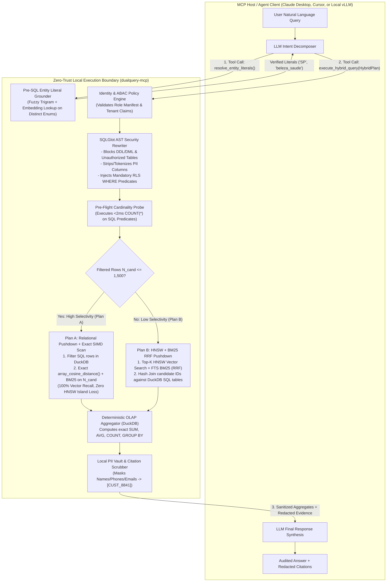

# DualQuery (`dualquery-mcp`)
## Document 01: System Architecture & Optimizer Specification (v2.0)

### 1. High-Level System Architecture

Unlike split two-database architectures that suffer from cross-process ID serialization between DuckDB and ChromaDB, `DualQuery v2.0` consolidates **relational OLAP tables**, **dense vector embeddings (`vss` HNSW)**, and **lexical BM25 full-text indexes (`fts`)** inside a single unified **DuckDB** memory space (with a pluggable **PostgreSQL + `pgvector` + Row-Level Security** adapter for multi-tenant server deployments).



---

### 2. Core Subsystem Specifications

#### Subsystem A: Unified Storage Engine (`DuckDB + vss + fts`)

Instead of maintaining a separate ChromaDB SQLite instance and passing tens of thousands of `order_id` strings across Python memory, all structured and unstructured modalities reside in `olist.duckdb`:

* **Relational Tables:** Normalized OLAP tables (`orders`, `order_payments`, `order_items`, `products`, `sellers`, `customers`).
* **Embedded Vector Column:** `order_reviews` stores a fixed-size array column `embedding FLOAT[384]` generated locally on CPU via `FastEmbed` (`BAAI/bge-small-en-v1.5`).
* **HNSW Vector Index:** Indexed in-process via DuckDB's `vss` extension:
  ```sql
  CREATE INDEX idx_reviews_hnsw ON order_reviews USING HNSW (embedding) WITH (metric = 'cosine');
  ```
* **Lexical BM25 Index:** Indexed in-process via DuckDB's `fts` extension:
  ```sql
  PRAGMA create_fts_index('order_reviews', 'review_id', 'review_comment_title', 'review_comment_message');
  ```
  This catches exact SKU numbers, carrier names, and error codes that dense embeddings miss.

---

#### Subsystem B: Pre-SQL Entity Value Grounder (Solving Dirty String Literals)

Real-world Text-to-SQL pipelines fail when users ask for *"Health & Beauty"* or *"São Paulo"*, while the underlying database stores `'beleza_saude'` or `'SP'`.

1. During ingestion, `DualQuery` builds a lightweight **Categorical Value Dictionary** indexing all low-to-medium cardinality text columns (`product_category_name`, `customer_state`, `order_status`, `payment_type`).
2. Before generating the hybrid query plan, the agent calls `resolve_entity_literals(terms=["electronics", "Rio de Janeiro"])`.
3. Using Jaro-Winkler string similarity + `FastEmbed` cosine similarity, the engine returns exact canonical database literals:
   ```json
   {
     "electronics": {"column": "products.product_category_name", "canonical_value": "eletronicos", "confidence": 0.96},
     "Rio de Janeiro": {"column": "customers.customer_state", "canonical_value": "RJ", "confidence": 0.99}
   }
   ```

---

#### Subsystem C: Mathematical Cost-Based Physical Query Optimizer

When a query contains both relational predicates $P_{\text{sql}}$ and semantic text predicates $P_{\text{sem}}$, the optimizer avoids static heuristics (`selectivity < 5%`) and instead runs a `<2ms` **Pre-Flight Cardinality Probe**:

$$\hat{N}_{\text{cand}} = \text{SELECT COUNT(DISTINCT order\_id) FROM } R \text{ WHERE } P_{\text{sql}}$$

It then evaluates the physical cost equations:

$$C_{\text{Plan A (Exact Subset Scan)}} = C_{\text{sql\_filter}}(N) + \hat{N}_{\text{cand}} \cdot \left(c_{\text{simd\_cos}} + c_{\text{bm25}}\right)$$

$$C_{\text{Plan B (HNSW Index Pushdown)}} = C_{\text{hnsw}}(\log N, ef_{\text{search}}) + C_{\text{fts}}(N) + K \cdot c_{\text{hash\_join}}$$

Where:

* **$N_{\text{cand}} \le 5,000$ (Plan A — Relational Filter $\rightarrow$ Exact SIMD Distance + BM25):**
  In DuckDB, scanning $\le 5,000$ pre-filtered `FLOAT[768]` vectors using hardware-accelerated AVX2 SIMD `array_cosine_distance(embedding, $query_vec)` maintains **$< 400\text{ms}$** turn latency.  
  *Crucial Engineering Advantage:* **Plan A completely bypasses the HNSW graph**, guaranteeing **100.0% exact vector recall** and eliminating the HNSW "isolated island" graph disconnection bug under restrictive filters. The inflection threshold was calibrated empirically to $N_{\text{cand}} = 5,000$ based on local AVX2 throughput benchmarks (up from the initial theoretical 1,500 baseline).

* **$N_{\text{cand}} > 5,000$ (Plan B — HNSW ANN + BM25 RRF $\rightarrow$ Relational Hash Join):**
  When the SQL filter is broad (e.g., `order_status = 'delivered'`, matching 96,000+ rows), the optimizer queries the HNSW index (`ORDER BY array_cosine_distance(embedding, $query_vec) LIMIT $k_ann`) and the FTS BM25 index (`fts_main_order_reviews.match_bm25(...)`) in parallel, fuses the top candidates via **Reciprocal Rank Fusion (RRF)**:

  $$\text{RRF\_Score}(d) = \frac{1}{60 + \text{rank}_{\text{vec}}(d)} + \frac{1}{60 + \text{rank}_{\text{bm25}}(d)}$$

  and hash-joins the resulting review records against the relational tables in DuckDB.
